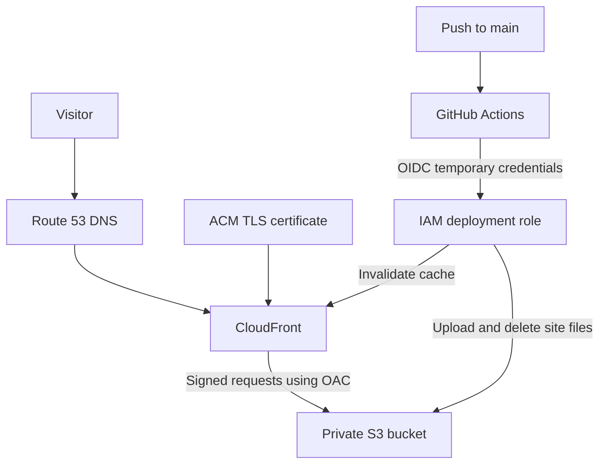

# AWS Portfolio Site

Personal portfolio deployed on AWS using CloudFormation and GitHub Actions.

**Website:** https://gabriele-giancane.com

## Architecture



- S3 stores the website files with all four Block Public Access settings enabled.
- CloudFront accesses S3 through Origin Access Control (OAC).
- The bucket policy grants CloudFront read access restricted to this distribution.
- CloudFront redirects HTTP requests to HTTPS.
- ACM provides the certificate in `us-east-1`, as required by CloudFront.
- Route 53 A and AAAA alias records connect the domain to CloudFront.
- GitHub Actions publishes changes using temporary AWS credentials obtained through OIDC.

## Deployment

### Prerequisites

- AWS account and authenticated AWS CLI.
- Git and a GitHub repository.
- A registered domain and a public Route 53 hosted zone.
- Permissions to manage the resources defined in `template.yaml`.

This project uses the AWS CLI profile `portfolio` and region `us-east-1`.

### Create the infrastructure

Run from the repository root:

```bash
aws cloudformation deploy \
  --template-file template.yaml \
  --stack-name portfolio-site \
  --parameter-overrides \
    DomainName=gabriele-giancane.com \
    HostedZoneId=Z00426862HEY3D1Y8X8LH \
  --region us-east-1 \
  --profile portfolio
```

Replace the domain and hosted zone ID when deploying in another account.

CloudFormation creates the bucket, OAC, CloudFront distribution, ACM certificate and DNS alias records. Certificate validation and CloudFront deployment can take several minutes.

Display the stack outputs:

```bash
aws cloudformation describe-stacks \
  --stack-name portfolio-site \
  --query "Stacks[0].Outputs" \
  --output table \
  --region us-east-1 \
  --profile portfolio
```

### Configure GitHub Actions authentication

The following resources were configured separately in IAM and are not included in `template.yaml`:

1. An OIDC provider:
   - Provider URL: `https://token.actions.githubusercontent.com`
   - Audience: `sts.amazonaws.com`
2. The `GitHubPortfolioDeploy` IAM role.
3. A trust policy allowing `sts:AssumeRoleWithWebIdentity` only for the intended repository and `main` branch.
4. A permissions policy allowing:
   - `s3:ListBucket` on the website bucket.
   - `s3:GetObject`, `s3:PutObject` and `s3:DeleteObject` on its objects.
   - `cloudfront:CreateInvalidation` on the website distribution.

The working trust policy checks the audience and this repository's actual OIDC subject:

```text
repo:Gabrielewebdev@147814155/portfolio-site@1441781686:ref:refs/heads/main
```

For a different repository, inspect its actual token claims before configuring the trust policy. Do not assume the subject has the same format.

The workflow requires:

```yaml
permissions:
  contents: read
  id-token: write
```

Update the role ARN, bucket name and distribution ID in `.github/workflows/deploy.yml` when deploying a separate copy.

No AWS access keys are stored in GitHub secrets.

### Publish website updates

Push changes under `site/` to `main`.

The workflow:

1. Checks out the repository.
2. Checks that `site/index.html` exists and is not empty.
3. Assumes the IAM role through OIDC.
4. Synchronizes `site/` to S3 using `--delete`.
5. Requests a CloudFront cache invalidation.

Changes to the workflow also trigger a deployment. A manual run is available through `workflow_dispatch`.

Infrastructure changes require a separate CloudFormation deployment.

## Testing

### Website availability

```bash
curl -I https://gabriele-giancane.com
```

Expected: `200 OK` after the website has been published.

### HTTP to HTTPS redirect

```bash
curl -I http://gabriele-giancane.com
```

Verified: `301 Moved Permanently` with a `Location` header pointing to HTTPS.

### Anonymous S3 access

```bash
curl -I https://portfolio-site-sitebucket-pgkzwhwskysf.s3.us-east-1.amazonaws.com/index.html
```

Verified: `403 Forbidden`. The website is accessible through CloudFront, while this anonymous direct request to S3 is denied.

### Automated deployment

Change visible text in `site/index.html`, commit and push to `main`.

Check that the GitHub Actions run succeeds and that the updated text appears on the website after cache invalidation propagates.

This was verified with a visible change to the architecture section.

## Costs

- Domain registration: **USD 16 for one year**, purchased through Route 53.
- Automatic domain renewal: disabled.
- Route 53 hosted zone: approximately **USD 0.50 per month**.
- S3 and CloudFront: usage-based charges, affected by traffic and applicable free allowances.
- ACM public certificate used with CloudFront: no additional certificate charge.

For a small portfolio, the expected running cost is approximately **USD 0.50–2 per month**, excluding the annual domain registration and applicable taxes.

These are estimates, not a spending cap. AWS Budgets sends alerts; it does not automatically stop resources.

## What I Learned

- How to describe AWS infrastructure in a CloudFormation template.
- How DNS aliases connect a domain to CloudFront.
- Why CloudFront requires its ACM certificate in `us-east-1`.
- How OAC lets CloudFront access a private S3 bucket using signed requests.
- How GitHub Actions obtains temporary AWS credentials through OIDC.
- How trust policies and permissions policies serve different purposes.
- How to troubleshoot an OIDC authentication failure by inspecting `iss`, `aud` and `sub`.
- How to verify HTTPS redirects and denied anonymous S3 access.
- How cache invalidation makes updated website files available through a CDN.

## Troubleshooting

If a CloudFormation deployment fails, inspect the stack events:

```bash
aws cloudformation describe-stack-events \
  --stack-name portfolio-site \
  --region us-east-1 \
  --profile portfolio
```

CloudFormation normally attempts to roll back a failed deployment. Inspect the events and final stack status before retrying; rollback can also fail.

If GitHub Actions cannot assume the deployment role, compare the token's issuer, audience and subject with the IAM provider and role trust policy. Never print the complete token in logs.

If the website displays old content, check that the S3 upload succeeded and inspect the CloudFront invalidation status.

## Cleanup and Recreation

The live portfolio is intended to remain online. The following commands remove it.

First empty the website bucket. This permanently deletes its current website files:

```bash
aws s3 rm s3://portfolio-site-sitebucket-pgkzwhwskysf \
  --recursive \
  --region us-east-1 \
  --profile portfolio
```

Then request stack deletion:

```bash
aws cloudformation delete-stack \
  --stack-name portfolio-site \
  --region us-east-1 \
  --profile portfolio
```

Wait for deletion to finish:

```bash
aws cloudformation wait stack-delete-complete \
  --stack-name portfolio-site \
  --region us-east-1 \
  --profile portfolio
```

Domain registration, the existing hosted zone and manually configured IAM resources are outside this stack and remain in the account.

To recreate the infrastructure, run the deployment command again. Then update the deployment workflow and IAM permissions with the new bucket name and distribution ID, and publish the website files.

A complete deletion and recreation has not yet been tested.

## Next Steps

- Manage the GitHub OIDC role and permissions through infrastructure as code.
- Remove hardcoded deployment resource identifiers from the workflow.
- Automate cleanup and recreation.
- Add automated CloudFormation validation.
- Complete the Notes serverless and EC2 projects and link their repositories.
