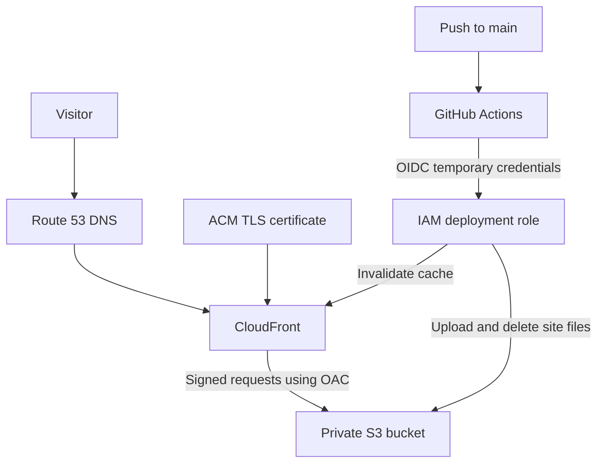

# AWS Portfolio Site

Personal portfolio deployed on AWS using CloudFormation and GitHub Actions.

**Website:** https://gabriele-giancane.com

## Architecture



- S3 stores the website files with all four Block Public Access settings enabled.
- CloudFront accesses S3 through Origin Access Control (OAC).
- The bucket policy grants CloudFront read access restricted to this distribution.
- CloudFront redirects HTTP requests to HTTPS.
- ACM provides the certificate in `us-east-1`, as required by CloudFront.
- Route 53 A and AAAA alias records connect the domain to CloudFront.
- GitHub Actions publishes changes using temporary AWS credentials obtained through OIDC.

## Deployment

### Prerequisites

- AWS CLI, Bash, Git and an authenticated AWS profile.
- A registered domain and correctly delegated public Route 53 hosted zone.
- An existing GitHub OIDC provider and `GitHubPortfolioDeploy` role.
- A role trust policy restricted to this repository's actual OIDC subject and main branch.
- Deployment permissions for CloudFormation, S3, CloudFront, ACM, Route 53
  and inline policy management on the deployment role.

Defaults in this repository target my AWS account and domain. Change them
before using the project in another account.

The OIDC provider and role trust configuration are external prerequisites.
CloudFormation manages the role's `PortfolioStackDeployment` permissions
policy, scoped to the stack, website bucket and CloudFront distribution.

The verified OIDC subject for this repository is:

```text
repo:Gabrielewebdev@147814155/portfolio-site@1441781686:ref:refs/heads/main
```

For another repository, inspect its actual claims rather than reusing this subject.

### Create or update infrastructure and publish

From the repository root:

```bash
bash scripts/deploy.sh
```

The script uses profile `portfolio` and region `us-east-1` by default.
It deploys the template, reads the stack outputs, uploads the website and
requests a CloudFront invalidation. It also works when infrastructure
has no changes.

Domain and hosted zone parameters have defaults in `template.yaml`.
Certificate validation and CloudFront provisioning can take several minutes.

### Continuous deployment

Push changes under `site/` or to `.github/workflows/deploy.yml` to `main`.
GitHub Actions authenticates through OIDC, reads the stack outputs,
synchronizes the site to S3 and requests cache invalidation.

No AWS access keys are stored in GitHub secrets.
Infrastructure changes require running the deployment script separately.
The workflow does not wait for invalidation completion.

## Testing

### Website availability

```bash
curl -I https://gabriele-giancane.com
```

Expected: `200 OK` after the website has been published.

### HTTP to HTTPS redirect

```bash
curl -I http://gabriele-giancane.com
```

Verified: `301 Moved Permanently` with a `Location` header pointing to HTTPS.

### Anonymous S3 access

```bash
curl -I https://portfolio-site-sitebucket-tvbr64qlwyqm.s3.us-east-1.amazonaws.com/index.html
```

Verified: `403 Forbidden`. The website is accessible through CloudFront, while this anonymous direct request to S3 is denied.

### Automated deployment

Change visible text in `site/index.html`, commit and push to `main`.

Check that the GitHub Actions run succeeds and that the updated text appears on the website after cache invalidation propagates.

This was verified with a visible change to the architecture section.

## Costs

- Domain registration: **USD 16 for one year**, purchased through Route 53.
- Automatic domain renewal: disabled.
- Route 53 hosted zone: approximately **USD 0.50 per month**.
- S3 and CloudFront: usage-based charges, affected by traffic and applicable free allowances.
- ACM public certificate used with CloudFront: no additional certificate charge.

For a small portfolio, the expected running cost is approximately **USD 0.50–2 per month**, excluding the annual domain registration and applicable taxes.

These are estimates, not a spending cap. AWS Budgets sends alerts; it does not automatically stop resources.

## What I Learned

- How to describe AWS infrastructure in a CloudFormation template.
- How DNS aliases connect a domain to CloudFront.
- Why CloudFront requires its ACM certificate in `us-east-1`.
- How OAC lets CloudFront access a private S3 bucket using signed requests.
- How GitHub Actions obtains temporary AWS credentials through OIDC.
- How trust policies and permissions policies serve different purposes.
- How to troubleshoot an OIDC authentication failure by inspecting `iss`, `aud` and `sub`.
- How to verify HTTPS redirects and denied anonymous S3 access.
- How cache invalidation makes updated website files available through a CDN.

## Troubleshooting

If a CloudFormation deployment fails, inspect the stack events:

```bash
aws cloudformation describe-stack-events \
  --stack-name portfolio-site \
  --region us-east-1 \
  --profile portfolio
```

CloudFormation normally attempts to roll back a failed deployment. Inspect the events and final stack status before retrying; rollback can also fail.

If GitHub Actions cannot assume the deployment role, compare the token's issuer, audience and subject with the IAM provider and role trust policy. Never print the complete token in logs.

If the website displays old content, check that the S3 upload succeeded and inspect the CloudFront invalidation status.

## Cleanup and Recreation

To remove the live website:

```bash
bash scripts/destroy.sh
```

The script shows the AWS identity and target bucket, requires typing
`portfolio-site`, empties the non-versioned bucket, deletes the stack
and waits for deletion to complete. This takes the website offline.

Domain registration, the hosted zone, the OIDC provider and deployment
role remain outside the stack. The stack-managed deployment permissions
policy is deleted with the stack.

To recreate the stack and upload the website:

```bash
bash scripts/deploy.sh
```

The workflow reads the new bucket and distribution identifiers from
CloudFormation. Its resource permissions are also generated by the template.

Full deletion and recreation were tested successfully on 2026-11-02. The recreated website returned HTTP 200 over HTTPS.
These commands recreate the application stack, not an entire AWS account.

## Next Steps

- Test a complete deletion and recreation during a planned maintenance window.
- Manage the external OIDC bootstrap through infrastructure as code.
- Add automated CloudFormation validation.
- Complete the Notes serverless and EC2 projects and link their repositories.
